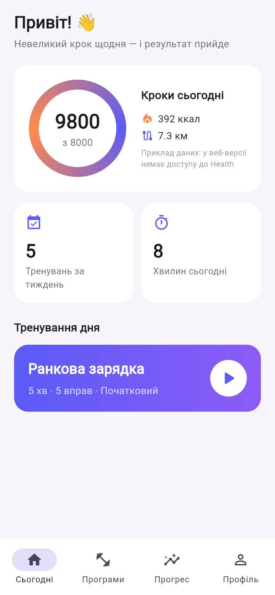
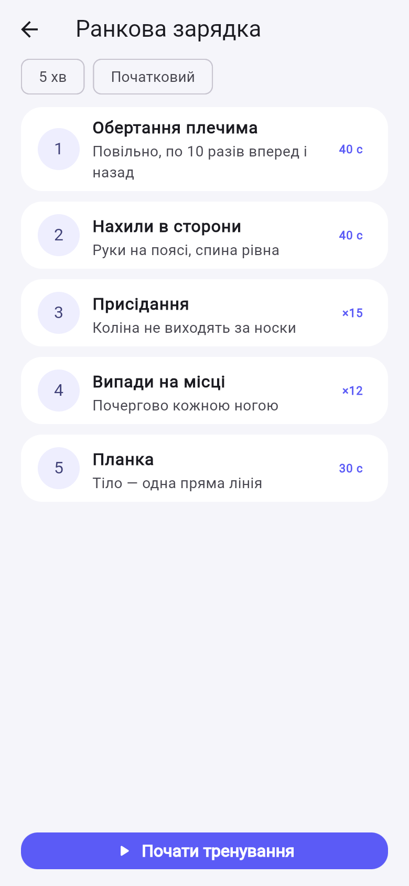
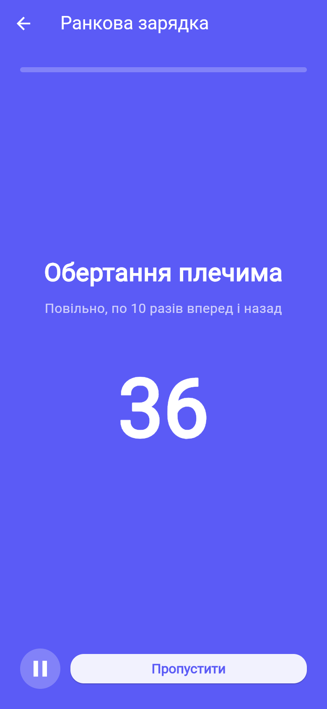
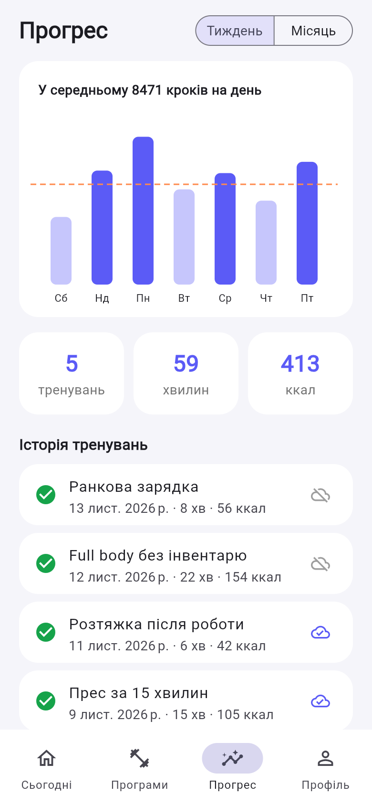

# FitHome — застосунок для тренувань вдома (Flutter, iOS + Android)

**Живе демо:** https://andreyvalko01-pixel.github.io/fithome-flutter/ (веб-збірка; кроки там демонстраційні — у браузері немає доступу до Health)

Один код для iOS і Android: програми тренувань з таймером і покроковими вправами, кроки з Apple Health / Health Connect, графіки прогресу, офлайн-режим із синхронізацією у Firebase.

| Сьогодні | Програма | Тренування | Прогрес |
| --- | --- | --- | --- |
|  |  |  |  |

> Скріншоти зроблені з веб-збірки (`flutter build web`). У браузері немає доступу до Health, тому кроки там демонстраційні — застосунок прямо пише про це на головному екрані. На телефоні дані беруться з Apple Health / Health Connect.

## Можливості

- **Програми тренувань** — ранкова зарядка, full body, прес, розтяжка; вправи на час і на повтори, кола, відпочинок між вправами
- **Плеєр тренування** — великий таймер, підказка техніки, «далі буде», пауза, пропуск, «Готово» для вправ на повтори, прогрес-бар
- **Кроки** — Apple Health (iOS) і Health Connect (Android) через пакет `health`; кільце денної цілі, калорії, кілометри
- **Прогрес** — графіки кроків за тиждень і місяць (fl_chart) з лінією цілі, підсумки тренувань, історія
- **Офлайн-режим** — усе зберігається на пристрої; завершені тренування стають у чергу і відправляються в Firestore, щойно з'являється інтернет (позначка ☁ в історії)
- **Firebase** — анонімний вхід (Auth), синхронізація (Firestore), push-нагадування (FCM, тема `workout_reminders` + година нагадування в профілі користувача)
- **Стан** — Riverpod; логіка плеєра винесена в окремий клас без UI і покрита тестами

## Стек

Flutter 3, Dart, Riverpod, Firebase (Auth, Firestore, Cloud Messaging), health, fl_chart, shared_preferences, connectivity_plus.

## Запуск

```bash
flutter pub get
flutter run                 # підключений телефон або емулятор
```

### Firebase

Без Firebase застосунок працює повністю локально. Щоб увімкнути синхронізацію і push:

```bash
dart pub global activate flutterfire_cli
flutterfire configure        # перезапише lib/firebase_options.dart
```

і в `lib/firebase_options.dart` встановити `firebaseConfigured = true` (команда згенерує файл, константу треба додати один раз).

### Health

- iOS: увімкнути HealthKit у Xcode → Signing & Capabilities, додати `NSHealthShareUsageDescription` в `Info.plist`
- Android: встановлений Health Connect, дозвіл `android.permission.health.READ_STEPS` у `AndroidManifest.xml`

## Тести

```bash
flutter test
```

## Структура

```
lib/
  main.dart, theme.dart, providers.dart
  models.dart                     — вправа, програма, сесія, кроки
  data/programs.dart              — програми тренувань
  data/local_store.dart           — локальне сховище і черга синхронізації
  services/workout_runner.dart    — логіка таймера і переходів між вправами
  services/steps_service.dart     — кроки (Health на телефоні, демо у вебі)
  services/sync_service.dart      — Firebase: Auth, Firestore, FCM
  screens/                        — головна, програми, тренування, прогрес, профіль
```
